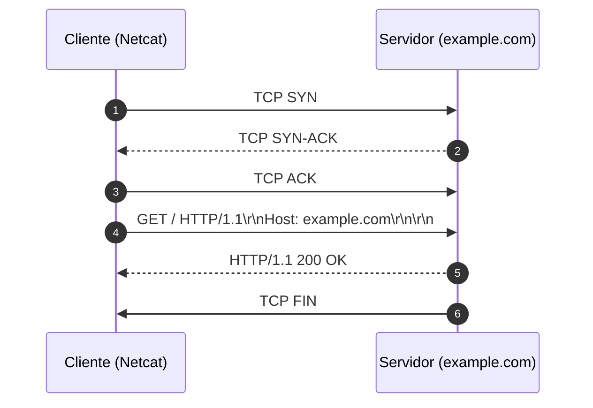

# Memória de Desenvolvimento — Semana 01
**Aluno:** Igor G. de Almeida 
**Curso:** Engenharia da Computação  

---

## 1. Mapeamento da Camada de Transporte
Diagrama Mermaid demonstrando o ciclo de vida da requisição executada no laboratório:

---

## 2. Captura Bruta e Análise do Protocolo
* **Comando Utilizado:** `nc -C example.com 80`
* **Status Line Retornada:** `HTTP/1.1 200 OK`

### Análise dos Headers Recebidos:
1. **`Content-Type`:** Esse campo indica o tipo de conteúdo que vem no arquivo enviado, no caso visto em aula o conteúde está em HTML e codificado em utf8, dessa forma ajuda o parser a interpretar corretamente por já saber o tipo esperado. 
2. **`Content-Length`:** Esse cabeçalho informa o tamanho do corpo da mensagem HTTP em bytes, permitindo que o parser saiba quantos bytes deve ler da stream TCP para identificar o fim do payload. Como o TCP transmite um fluxo contínuo de bytes, sem delimitar mensagens HTTP automaticamente, o Content-Length ajuda o cliente a identificar onde termina o corpo da resposta. No caso analisado, foi utilizado Transfer-Encoding: chunked, que delimita o corpo por blocos, dispensando o uso do Content-Length.
3. **`Connection: close`:** Quando fechamos o socket imediatamente após a reposta é encerrada aquela conexão, se quisermos receber novas repostas será necessário estabalecer outro socket TCP. Com o keep-alive o socket TCP se mantém conectado mesmo após a resposta chegar, possibilitando novas repostas serem enviadas e recebidas(os navegadores trabalham de forma semelhantes, sua conexão TCP não é encerrada após as primeiras respostas elas ficam um tempo aguardando.).
---

## 3. Conclusão Técnica
Compreender o HTTP como uma transmissão de bytes pela rede é importante para entender como ocorre a comunicação entre cliente e servidor. Diferentemente de um arquivo estático local, os dados são enviados por uma conexão TCP e podem chegar em partes. As linhas dos cabeçalhos são separadas por CRLF (`\r\n`), e a sequência `\r\n\r\n` indica o fim dos cabeçalhos. Por isso, é necessário interpretar corretamente os dados recebidos e identificar o tamanho do conteúdo para que o parser consiga processar a mensagem HTTP sem erros.
